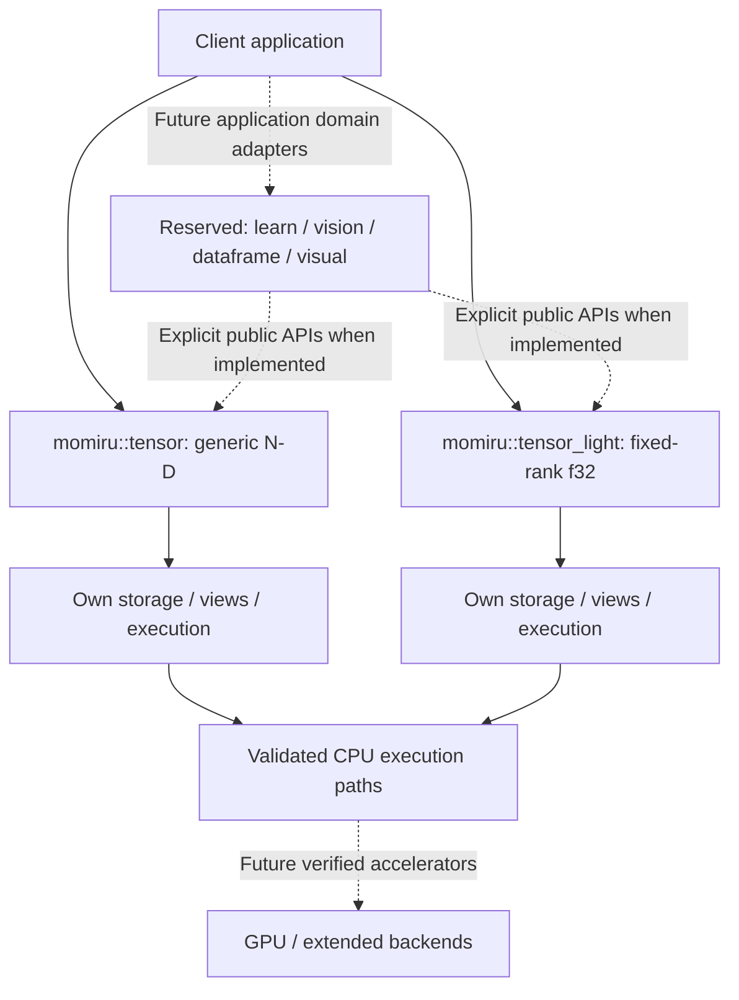
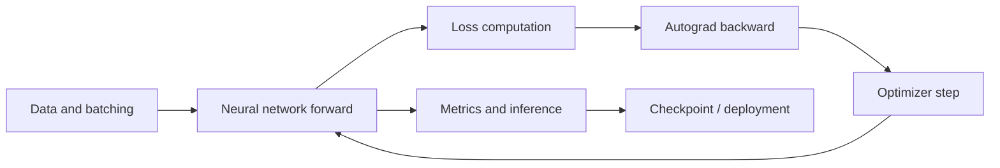

<!-- SPDX-FileCopyrightText: 2026 Morteza Taleblou -->
<!-- SPDX-FileCopyrightText: 2026 Mitra Daneshmand -->
<!-- SPDX-License-Identifier: MIT -->

<div align="center">


# Momiru

### A performance-driven, Rust-native foundation for a complete AI framework

**Building toward a modern, open-source alternative to PyTorch — with explicit execution contracts, dependable tensor computation, and a path to deep learning at scale.**

[](https://www.rust-lang.org/)
[](LICENSE)


[Vision](#vision-and-goals) · [Current status](#current-implementation-status) · [Architecture](#architecture) · [Roadmap](#development-roadmap) · [Getting started](#getting-started) · [Contributors](#authors-ownership-and-governance) · [License](#license)

</div>

> **Project status:** Momiru contains a real **Rust tensor-library source baseline** with two independent public tensor modules, tests, examples, CPU-oriented benchmarks, and execution-plan infrastructure. It is **not yet a complete deep-learning framework or a drop-in PyTorch replacement**. Supported execution must be verified through actual builds, tests, and benchmarks; reserved directories are not implemented features.

## What is Momiru?

**Momiru** is an MIT-licensed, Rust-native project for high-performance tensor computation and, ultimately, an integrated AI/ML ecosystem. The long-term ambition is a dependable framework for tensor operations, automatic differentiation, neural networks, training, evaluation, computer vision, data processing, and deployment — capable of replacing PyTorch in workloads that Momiru explicitly supports and validates.

Momiru is a separate Rust implementation from **[Momijo](https://github.com/taleblou/momijo)**, its Mojo-native sibling. Both share co-founders and technical ambitions; neither implies binary compatibility, identical public APIs, or shared internals.

## Vision and goals

We aim to build an AI framework with the **expressiveness researchers expect** and the **control and predictable performance systems programmers need**.

1. **Correct tensors first:** type, shape, stride, layout, indexing, broadcasting, memory ownership and numerical behavior must be well-defined.
2. **High performance:** optimize CPU operations and introduce GPU/device backends only with validated, workload-specific evidence.
3. **Safe, explicit execution:** use documented Rust ownership contracts, checked buffer/view lifetimes, and bounded `unsafe` code only where justified.
4. **Automatic differentiation:** implement a sound gradient engine with verifiable backward rules.
5. **Complete learning workflows:** models, layers, losses, optimizers, schedulers, data loaders, checkpoints, and inference.
6. **Scalable ecosystem:** add vision, dataframes, visualization, profiling, mixed precision, and eventually distributed/accelerated workloads.
7. **Open engineering:** publish tests, known limitations, benchmark methodology and release evidence.

**Replacing PyTorch is the strategic destination, not a present feature-parity claim.** Any compatibility promises or performance comparisons must be backed by an explicit feature matrix and reproducible tests. Existing PyTorch Python programs are not assumed to run unchanged.

## Current implementation status

The status below describes the checked-in source tree reviewed on **11 November 2026**. **Source present** means implemented files exist; it does not claim that tests passed, artifacts were released, or GPU execution is available.

| Area | Status in this source snapshot | Scope / evidence |
| --- | --- | --- |
| `momiru::tensor` | **Source present** | Generic-element tensors, runtime-defined N-D shapes, host storage/views, indexing and explicit CPU numerical paths. |
| `momiru::tensor_light` | **Source present** | Independent fixed-rank `f32` tensor edition, with compile-time rank **0–8**, owned storage/views and constrained execution. |
| Execution-plan infrastructure | **Source present** | UASDEA-style validated/frozen plans, execution modules, CPU paths and AOT prototype components. |
| CPU-oriented optimization work | **Source present** | SIMD/ISA- and workload-specific code paths, tests, and benchmarks; measured gains not asserted. |
| Tests | **Sources present** | Unit, integration, conformance and canonical suites for both editions. |
| Examples and benchmarks | **Sources present** | Separate tensor and `tensor_light` examples and offline benchmark targets. |
| Repository infrastructure | **Present** | Cargo manifest/lock, pinned Rust toolchain, build script, GitHub workflows and maintainer documentation. |
| Rust build and test pass | **Not verified in this review** | A Rust compiler/Cargo toolchain was not available in the review environment. |
| GPU backend and signed artifact loader | **Not verified / not shipped as a complete runtime** | Do not infer them from prototype or target abstractions. |
| `momiru::dataframe` | **Reserved only** | Future domain directory, not a registered Rust module. |
| `momiru::learn` | **Reserved only** | Future autograd/training domain, not a registered Rust module. |
| `momiru::vision` | **Reserved only** | Future domain directory, not a registered Rust module. |
| `momiru::visual` | **Reserved only** | Future domain directory, not a registered Rust module. |

**Programming-language source policy:** Momiru contains only Rust (`.rs`) code. Markdown, TOML, YAML, the Cargo lockfile and GitHub metadata are documentation and configuration rather than additional programming-language implementations. There are exactly **two tensor editions**; `dataframe`, `learn`, `vision`, and `visual` are planned **peer domains**, not `*_light` variants. In particular, `src/lib.rs` currently exposes **only** `tensor` and `tensor_light`, with **no root `momiru::Tensor` alias**.

## Architecture

### Single crate; two explicitly selected tensor APIs

```text
momiru/
├── src/
│   ├── lib.rs                # Exposes tensor and tensor_light
│   ├── tensor/               # Generic-element, runtime-ND tensor edition
│   ├── tensor_light/         # Independent fixed-rank f32 tensor edition
│   ├── dataframe/            # Reserved: future data processing
│   ├── learn/                # Reserved: future autograd / neural networks
│   ├── vision/               # Reserved: future computer vision
│   └── visual/               # Reserved: future visualization
├── tests/                   # Edition-scoped unit/integration/conformance tests
├── examples/                # Existing tensor usage examples
├── benches/                 # Independent offline CPU benchmark targets
├── docs/                    # Architecture, developer guides and design decisions
├── .github/                 # CI, release and security workflows
├── build.rs                 # Conservative build/admission provenance checks
├── Cargo.toml               # Single crate, explicit features and bench targets
├── rust-toolchain.toml      # Pinned Rust toolchain
└── LICENSE                  # MIT, both copyright holders
```

| Aspect | `momiru::tensor` | `momiru::tensor_light` |
| --- | --- | --- |
| Intended use | General host tensors with runtime-determined dimensions | Specialized FP32 tensors with compile-time rank |
| Public tensor type | `Tensor<T>` | `Tensor<const R: usize>` (`f32` alias) |
| Shape/rank | Dynamic N-D | `R` from 0 through 8 |
| Supported numeric execution | Explicitly registered, typed CPU paths | Restricted built-in `f32` CPU provider for validated plans |
| Storage/views | Generic element and host view interfaces | Separate fixed-rank storage and view interfaces |
| Execution | Own plan, native, runtime, CPU and prototype AOT code | Own validated execution and feature-gated offline AOT code |
| Cross-edition conversion | Not implicit | Not implicit |

**UASDEA-based execution** is an architectural contract in the present source: numerical execution is associated with explicitly validated plans and supported capabilities, rather than an unconditional global eager-compute facade. The current AOT and artifact identities are **prototypes**, not claims of a cryptographically signed production release system.



The diagram is a **high-level architectural view**, not a promise that reserved domains or GPU execution already work. Read [architecture overview](docs/architecture/overview.md), [module boundaries](docs/architecture/module-boundaries.md), [UASDEA contracts](docs/architecture/uasdea.md), [AOT/artifacts](docs/architecture/aot-and-artifacts.md), and [ADR 0001](docs/adr/0001-single-crate-independent-tensor-modules.md).

## Development roadmap

These milestones are **planned engineering phases**, not fixed release dates. A feature counts as complete only with tested and documented supported configurations.

| Phase | Focus | Expected deliverables | Acceptance gate | Position |
| --- | --- | --- | --- | --- |
| **R0 — Foundation** | Consolidated Rust source and architecture | One Cargo crate, independent tensor APIs, dual-author MIT attribution, tests, examples, docs, CI workflows. | Source structure and contracts review. | **Source established** |
| **R1 — Verified tensor engines** | Establish a dependable baseline | Compile/test both tensor editions on pinned toolchain, validate edge cases and CPU execution plans. | `cargo test`, conformance and cross-platform CI with public logs. | **Next verification gate** |
| **R2 — CPU performance and execution** | Efficient numerical computing | Optimize hot paths, SIMD/parallel CPU execution, offline AOT validation, memory reuse. | Correctness parity, measured latency/throughput, no unsafe regressions. | Existing source work; validation pending |
| **R3 — Autograd** | Reverse-mode differentiation | Graph/tape design, backward kernels, gradient accumulation and controls. | Reference/finite-difference gradient checks. | Planned |
| **R4 — `learn` training framework** | Train useful models end to end | Modules/layers, losses, optimizers, schedulers, datasets, batch loading, checkpointing. | Reproducible training, inference and resume examples. | Reserved today |
| **R5 — Devices and AI domains** | Broader acceleration and workloads | Verified GPU backend(s), device transfer; `vision`, `dataframe`, `visual` modules with explicit adapters. | Device parity, independent module tests and supported-platform matrix. | Planned |
| **R6 — Advanced deep learning** | Competitive model capabilities | Mixed precision, attention/Transformers, efficient inference, distributed execution where appropriate. | Model-level parity, convergence tests, end-to-end benchmarks. | Long-term goal |
| **R7 — Stable PyTorch-alternative workflows** | Trustworthy public distribution | Versioned APIs, tutorials, feature comparison, crates/release workflow, upgrade/migration guidance. | Reviewable compatibility matrix, security and performance evidence, stable release criteria. | Long-term goal |

### What happens next?

The immediate priority is **R1: compile, execute and validate the two existing tensor editions** using Rust 1.99.1, including the optional AOT feature. Capture CI evidence and representative CPU benchmark results; identify remaining gaps before starting the autograd core and initial model-training pipeline.

### Intended model-training workflow (future)



This describes the intended **full framework**; the `learn` module and these training interfaces are **not yet implemented** in the provided snapshot.

## Getting started

### Requirements

- **Rust 1.99.1**, pinned in [`rust-toolchain.toml`](rust-toolchain.toml), with Cargo, Clippy and rustfmt.
- The provided package is Rust **edition 2021**, version **0.1.0** as a source baseline; this version number is **not proof of a published release**.
- No third-party Rust crate dependencies are currently declared in `Cargo.toml`.
- A supported target for the relevant CPU functionality; architecture-specific optimizations remain guarded by their own contracts.

Clone or unpack the project, then run from its root:

```bash
cargo check --locked
cargo check --locked --all-targets
cargo test --locked
cargo test --locked --features aot
cargo fmt --all -- --check
cargo clippy --all-targets --all-features -- -D warnings
```

Run examples from each **existing** tensor edition:

```bash
cargo run --example tensor_basic
cargo run --example tensor_light_basic
```

For example, the general edition supports generic-element host storage:

```rust
use momiru::tensor::Tensor;

fn main() -> Result<(), Box<dyn std::error::Error>> {
    let mut values = Tensor::from_vec([2, 3], vec![0_i64, 1, 2, 3, 4, 5])?;
    values[[1, 2]] = 42;
    assert_eq!(values[[1, 2]], 42);
    Ok(())
}
```

The fixed-rank edition instead uses `momiru::tensor_light::Tensor::<R>` with an `f32` payload, as shown in [`examples/tensor_light_basic.rs`](examples/tensor_light_basic.rs). The API types are deliberately distinct, and no root-level `momiru::Tensor` is provided.

**Verification note:** The above commands and snippet are grounded in the source tree; **Rust/Cargo execution was not available in this review environment**. They must be run before public claims of successful compilation or stable compatibility.

See [getting started](docs/getting-started.md), [API reference](docs/reference/README.md), [compatibility and limitations](docs/compatibility.md), [setup](docs/development/setup.md), [testing](docs/development/testing.md), [troubleshooting](docs/troubleshooting.md), and the [Tensor](docs/guides/tensor.md) / [Tensor Light](docs/guides/tensor_light.md) guides.

## Testing, benchmarking and release standards

Correctness and credible performance evidence are central to Momiru's direction:

- **Type and shape safety:** scalar/empty/high-rank inputs, overflow, indices, aliases, views, layouts and lifetimes.
- **Numerical behavior:** stable reductions, IEEE edge cases, precision guarantees and typed operation dispatch.
- **Execution contracts:** bound/frozen plans, CPU capability checks, output initialization, replay behavior, and conservative unsupported-target handling.
- **Memory safety:** review `unsafe` invariants and test aliasing, initialization and bounds assumptions.
- **Autograd (future):** analytical and finite-difference tests for each differentiable operation.
- **Performance:** publish hardware, compiler/profile, workload shapes, warmups, threads, timing methodology, baseline and variability.
- **Releases:** pass relevant test/CI gates, document actual hardware coverage, and avoid presenting AOT prototypes as signed production artifacts.

For an existing offline benchmark target, use `cargo bench --bench tensor_cpu_matmul` only after confirming your toolchain/build. A benchmark **file** does not establish a benchmark **result**. See [benchmarking](docs/performance/benchmarking.md), [reproducibility](docs/performance/reproducibility.md), and [safety](docs/security/safety.md).

## Documentation and contribution

| Resource | Purpose |
| --- | --- |
| [Documentation index](docs/README.md) | Architecture and engineering references. |
| [Getting started](docs/getting-started.md) | Source-backed setup and examples. |
| [API reference](docs/reference/README.md) | Public entry points, source-backed examples, and complete local Rustdoc generation. |
| [Compatibility](docs/compatibility.md) | Current implementation boundaries and unverified platform/runtime claims. |
| [Troubleshooting](docs/troubleshooting.md) | Toolchain, import, shape, view, and plan-admission diagnostics. |
| [Release verification](docs/development/release.md) | GitHub upload, tests, legal, and publication gates. |
| [UASDEA architecture](docs/architecture/uasdea.md) | Plan-based execution contracts. |
| [Testing](docs/development/testing.md) | Registered suites and correct validation claims. |
| [Contributing](CONTRIBUTING.md) | Code quality and PR workflow. |
| [Security](SECURITY.md) | Responsible vulnerability reports. |
| [Code of Conduct](CODE_OF_CONDUCT.md) | Community standards. |
| [Changelog](CHANGELOG.md) | Source and packaging history. |
| [Support](SUPPORT.md) | Project help and communication. |

Contributions should maintain explicit module boundaries, avoid unreviewed unsafe behavior, include tests for observable functionality, and provide reproducible benchmarks for optimization claims.

## Authors, ownership and governance

Momiru is jointly created and stewarded by **two founders, authors, and project co-owners**:

| Contributor | Roles |
| --- | --- |
| **Morteza Taleblou** | Co-founder · Co-owner · Author · Maintainer · Copyright holder |
| **Mitra Daneshmand** | Co-founder · Co-owner · Author · Maintainer · Copyright holder |

Both names are included in `Cargo.toml`, the source SPDX headers, and the MIT license. **Project co-ownership and authorship do not automatically configure GitHub organization or repository administrator privileges:** those permissions and `CODEOWNERS` reviews must be maintained separately.

**Repository:** [github.com/taleblou/momiru](https://github.com/taleblou/momiru)  
**Related Mojo project:** [github.com/taleblou/momijo](https://github.com/taleblou/momijo)  
**Project website:** [taleblou.ir](https://taleblou.ir/)

## License

Momiru is released under the **[MIT License](LICENSE)**.

```text
Copyright (c) 2026 Morteza Taleblou
Copyright (c) 2026 Mitra Daneshmand
```

The MIT license permits use, modification and redistribution under its license-notice and copyright-preservation conditions. Read the full [LICENSE](LICENSE) for the exact legal terms and disclaimer.

---

**Momiru:** an independent Rust tensor foundation today, with the ambition to grow into a complete, efficient and reliable PyTorch alternative.
